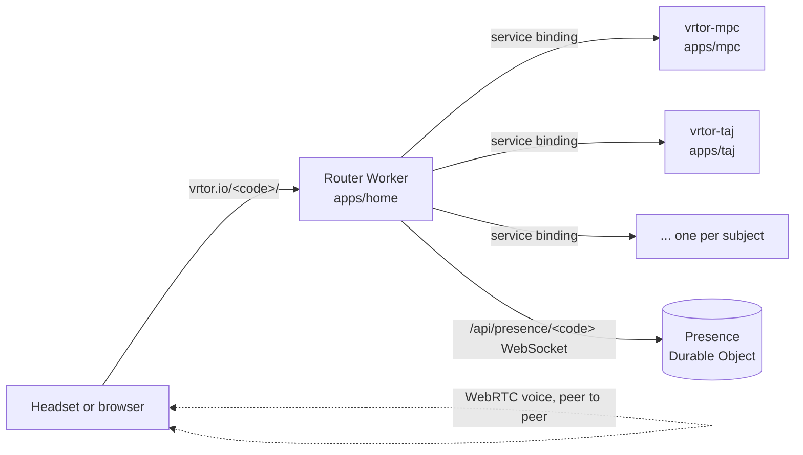

# vrtor.io

**Free 3D learning experiences, one per subject, that open in a VR headset's web browser.**
No app store, no install, no account: put on a headset, open the browser, type `vrtor.io/mpc`
and you are standing in Machu Picchu. Every subject also works on a laptop or phone.

[**Try it at vrtor.io**](https://vrtor.io) · [Architecture](docs/architecture.md) ·
[Add a subject](docs/adding-a-subject.md) · [Contributing](CONTRIBUTING.md) ·
[Asset licences](ASSETS.md)

The subjects try to be exact: real scans and measured replicas at real size, not illustrations.
Each address is a short code because typing with a VR controller is painful. In every 3D subject,
visitors can see and talk to each other ([Visitors](docs/visitors.md)).

## Subjects

| Code | Subject | What's inside |
|---|---|---|
| [`mpc`](https://vrtor.io/mpc) | Machu Picchu | The citadel walkable stone by stone, with CAST laser scans of three buildings in place ([notes](docs/subjects/mpc.md)) |
| [`giza`](https://vrtor.io/giza) | The Great Pyramid | Khufu's pyramid at real size, generated in the browser course by course from Petrie's survey |
| [`taj`](https://vrtor.io/taj) | Taj Mahal | A detailed exterior with observation activities ([notes](docs/subjects/taj.md)) |
| [`apo`](https://vrtor.io/apo) | Apollo 11 | Inside the command module Columbia, from the Smithsonian's scans, in lunar orbit ([notes](docs/subjects/apo.md)) |
| [`fly`](https://vrtor.io/fly) | Wright Flyer | The 1903 Flyer at Kill Devil Hills, from the Smithsonian's scan |
| [`spc`](https://vrtor.io/spc) | Space | Perseverance on Mars |
| [`orca`](https://vrtor.io/orca) | Orca | A killer whale skeleton, inside out |
| [`bdy`](https://vrtor.io/bdy) | The human body | A life-size body of 3,273 anatomical parts, every one of which comes out in your hands |
| [`hrt`](https://vrtor.io/hrt) | The heart | A normal adult heart from 19 adults' averaged CT, beating, valves opening and shutting |
| [`cel`](https://vrtor.io/cel) | The cell | An animal and a plant cell at 150,000x, drawn entirely in code ([notes](docs/subjects/cel.md)) |
| [`aif`](https://vrtor.io/aif) | AI foundations | Data, a neuron, error, gradient descent and a network, hands-on ([notes](docs/subjects/aif.md)) |
| [`snd`](https://vrtor.io/snd) | Sound Lab | English sound contrasts with a mouth cutaway and self-recording ([notes](docs/subjects/snd.md)) |
| [`mona`](https://vrtor.io/mona) | Mona Lisa | The C2RMF scan on its warped poplar panel, in its Louvre case |
| [`sacre`](https://vrtor.io/sacre) | The Coronation of Napoleon | David's painting at its real size in the Salle Daru |
| [`jump`](https://vrtor.io/jump) | Parachute | A skydive over Interlaken from swisstopo terrain |
| [`cyb`](https://vrtor.io/cyb) | Cybertruck | A full-size replica built from measurements, to walk round, sit in and take apart |
| [`rds`](https://vrtor.io/rds) | Roadster | The second-generation Roadster, built the same way |
| [`geo`](https://vrtor.io/geo) | Earth (unlisted) | The planet from open data, orbit to street level, on three.js ([notes](docs/subjects/geo.md)) |

## How it's built

One repository, one Cloudflare Worker per subject. A small router Worker owns `vrtor.io` and hands
each `/<code>/` path to that subject's Worker through a service binding, so every subject shares one
origin (one WebXR permission prompt, shared storage) while being built and deployed on its own.



- **`apps/home`**: the catalog site (plain HTML, CSS and a three.js scroll journey; no build step) and
  the router Worker (`src/index.js`, with the subject registry in `src/subjects.js`).
- **`apps/<code>`**: one subject each. Babylon.js and WebXR, built with Vite into `dist/<code>/` and
  served as static assets by a Worker of a dozen lines. (`geo` is the one three.js app.)
- **`packages/xr-shell`**: what every subject shares: a Quest-tuned XR session, teleport and snap turn,
  comfort fades, an adaptive frame-rate governor, floating info cards, presence avatars and voice.
- **`assets-src/` and `scripts/`**: how the models were made: Blender, build123d code-CAD and
  scan-processing pipelines that turn open data into the GLB and KTX2 files the apps ship.

The full tour is in [docs/architecture.md](docs/architecture.md).

## Run it locally

Needs Node 22.12 or newer. No Cloudflare account or keys are needed for local development.

```bash
npm install
npm run dev -- mpc        # http://localhost:8790/mpc/ (one subject: fast)
```

`npm run dev` with no codes builds and serves all of them (18 Vite watchers and 19 Workers, so give it
a minute). `npm test` runs the test suites, `npm run build` builds every app.

To try it in a headset, WebXR needs HTTPS: tunnel the dev server and open the printed URL plus `/mpc/`
in the headset's browser.

```bash
cloudflared tunnel --url http://localhost:8790
```

## Contributing

Bug reports, headset test results, fixes and new subjects are all welcome. Start with
[CONTRIBUTING.md](CONTRIBUTING.md); [docs/adding-a-subject.md](docs/adding-a-subject.md) walks through
a new subject end to end.

## Licence

The code is [MIT](LICENSE). The 3D models, scans, textures and data are **not** covered by that
licence: each keeps its own (CC0, CC BY, CC BY-SA, CC BY-NC, ODbL and others), listed in
[ASSETS.md](ASSETS.md) and in the credits next to the files. Some of them are non-commercial.
