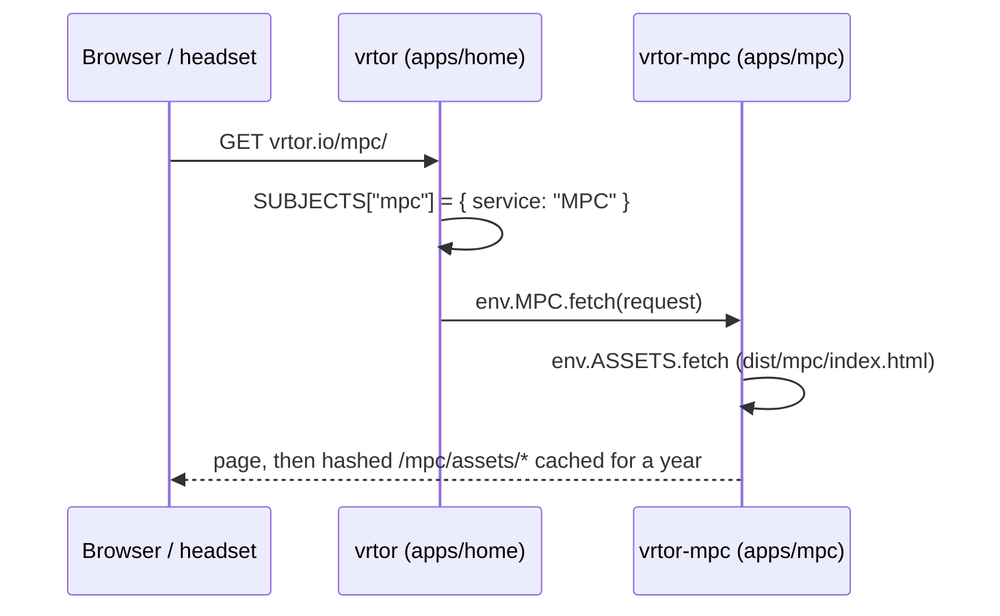

# Architecture

vrtor.io is a set of independent WebXR apps that look like one site. This page explains how the pieces
fit and why they are split the way they are.

## The shape

```
apps/home/            vrtor.io itself: catalog site + router Worker ("vrtor")
apps/<code>/          one subject each, its own Worker ("vrtor-<code>")
packages/xr-shell/    WebXR pieces every subject shares
assets-src/<subject>/ how a subject's models were built (code-CAD, scan processing)
scripts/              dev/build/deploy runners, asset preparation and checks
docs/                 this documentation
```

npm workspaces tie them together. `scripts/apps.js` lists the subject apps once; the root `build`,
`deploy` and `dev` scripts all read it.

## Requests: one origin, many Workers



`apps/home/src/index.js` runs first for every request:

- `/<code>/*` for a subject with a `service` in `src/subjects.js` is forwarded to that subject's Worker
  through its **service binding** (declared in `apps/home/wrangler.jsonc`). Service bindings are calls
  inside Cloudflare, not HTTP redirects, so every subject is on the same origin: one WebXR permission
  prompt, shared `localStorage`, and later one sign-in.
- Aliases (`/machu-picchu`, `/apollo11`, ...) redirect to the short code. Codes are three or four letters
  because typing with a VR controller is slow.
- A subject with a `url` is hosted elsewhere and is reached by redirect; one with neither is "coming soon"
  and goes to the catalog.
- `/api/presence/<code>` upgrades to a WebSocket on the presence Durable Object (below).
- `POST /api/waitlist` stores a signup in the `WAITLIST` KV namespace and, when the `BREVO_API_KEY`
  secret is set, adds it to the mailing list and sends a welcome email (`src/welcome-email.js`).

Each subject Worker (`apps/<code>/worker/index.js`) is about a dozen lines: it serves the Vite build
from Workers Static Assets and marks content-hashed files immutable. Subject Workers have
`workers_dev: false`, so they are reachable only through the router.

Why one Worker per subject rather than one big app: each subject has its own heavy dependencies and
assets (one is a 90 MB painting scan, another a beating heart), its own release cadence, and its own
failure domain. A broken build of one subject cannot take down another, and a contributor can work on
one subject without building the rest.

## A subject app

```
apps/<code>/
  package.json       @vrtor/<code>: build, watch, deploy (+ test where there is one)
  vite.config.js     base '/<code>/', outDir 'dist/<code>' so asset paths match the URL
  wrangler.jsonc     Worker "vrtor-<code>", static assets from ./dist
  worker/index.js    serves the build, caches hashed assets
  index.html
  src/main.js        the scene: Babylon.js engine, camera, content, UI
  public/            models (GLB, often Draco), KTX2 textures, decoders; copied as is
```

Subjects are written in plain modern JavaScript (ES modules, no TypeScript) on
[Babylon.js](https://www.babylonjs.com/) 9. The exception is `geo`, which uses three.js and
[3d-tiles-renderer](https://github.com/NASA-AMMOS/3DTilesRendererJS) for streamed map tiles.

Performance on a standalone headset (Meta Quest) is the design constraint throughout: textures ship as
KTX2 so they stay compressed in GPU memory, large meshes are Draco or meshopt compressed, shadow maps
are smaller on headsets, and distant detail is swapped for lighter versions. The per-subject notes in
[docs/subjects](subjects) go into the trade-offs.

## packages/xr-shell

Everything a subject would otherwise copy from another:

| Export | What it does |
|---|---|
| `createXr`, `xrSupported` | Quest-tuned immersive session: teleport, snap turn, comfort fade, foveation, MSAA layer |
| `FrameRateGovernor`, `RESOLUTION_SCALE` | lowers or raises the eye-buffer resolution to hold the frame rate |
| `createCard`, `createMenuControls`, `faceViewer` | floating info cards and menus that work in and out of VR |
| `createPresence`, `mountPresenceControls`, `presenceCard`, `orbitPose`, `xrPose` | visitors: avatars, names, spatial voice (see [visitors.md](visitors.md)) |
| `ROOMS`, `roomsCard`, `continueInVr` | the headset room switcher between subjects |
| `headsetLogging`, `startHeadsetLog` | on localhost and the dev tunnel only, posts a headset's state, notes and errors to the dev machine |

Its peer dependencies are `@babylonjs/core` and `@babylonjs/gui`; each subject brings its own copy.

## Visitors

Presence is one Durable Object per room (`apps/home/src/presence.js`), holding up to 12 people and
relaying poses and WebRTC signalling. Voice itself is peer to peer. Details and the headset budget are in
[visitors.md](visitors.md).

## Where the models come from

The apps ship finished assets in `public/`. How they were made is kept next to the code so it can be
reproduced and checked:

- `scripts/prepare-*.py` turn downloaded open data (Smithsonian scans, Sketchfab CC BY models,
  terrain and imagery) into what the apps load. Most run inside Blender:
  `blender -b --factory-startup --python scripts/prepare-orca.py -- <inputs>`.
- `assets-src/<subject>/` holds measured replicas built with [build123d](https://github.com/gumyr/build123d)
  code-CAD and assembled in headless Blender (`build.sh`, `cad.py`, `params.json`, `spec.md`), and
  scan-processing pipelines (`assets-src/body`, `assets-src/heart`) that fetch their inputs with
  `fetch.sh`. The method is the [building-3d-replicas](https://github.com/davo20019/building-3d-replicas)
  skill, kept in `.claude/skills`.
- Reference photos and manuals used for measuring replicas are copyrighted by others and are **not** in
  this repository; each `SOURCES.md` lists where they come from.
- `scripts/check-*.mjs` and `check-*.py` test the result: walking surfaces, physics, steering, sound.

Every asset's source and licence is in [ASSETS.md](../ASSETS.md).

## Local development

`npm run dev` (`scripts/dev.js`) builds the chosen subjects, then runs a Vite watcher and a
`wrangler dev` per subject plus the router on port 8790. Wrangler's local dev registry connects the
service bindings, so `localhost:8790/<code>/` behaves like production. KV, Durable Objects and R2 are
simulated locally; no Cloudflare account is needed. The router gets `DEV=1` so it doesn't redirect
`wrangler dev`'s `http://vrtor.io` requests to the live site.

## Deploying

`npm run deploy` deploys every subject Worker and then the router (the router's bindings need the
subjects to exist). It deploys to the Cloudflare account wrangler is logged in to; the custom domains,
KV namespace id and R2 bucket in the `wrangler.jsonc` files are vrtor.io's own, so a fork deploying
elsewhere changes those.
